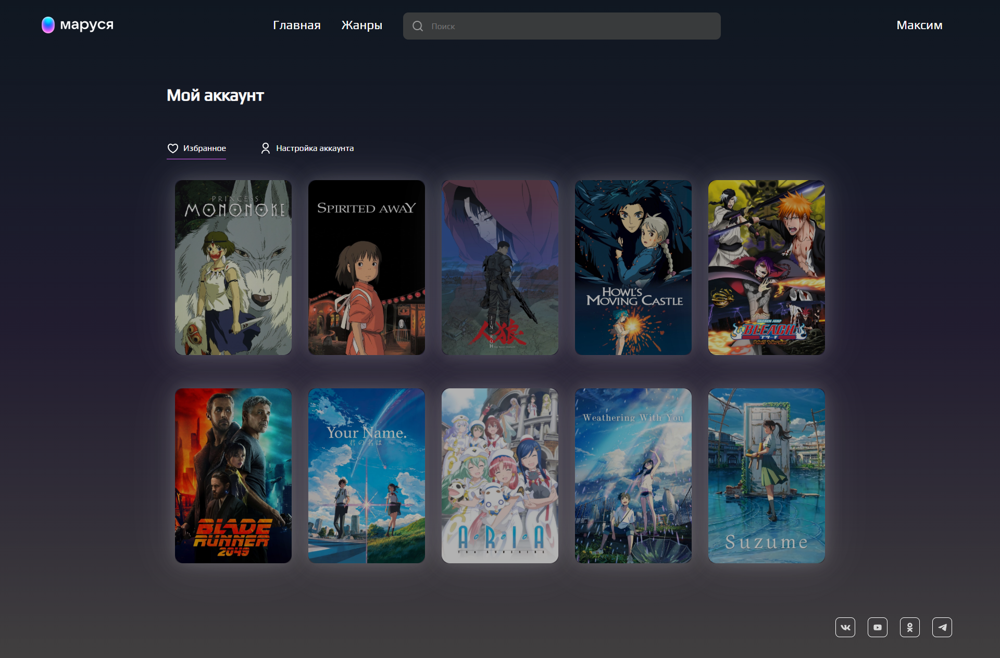
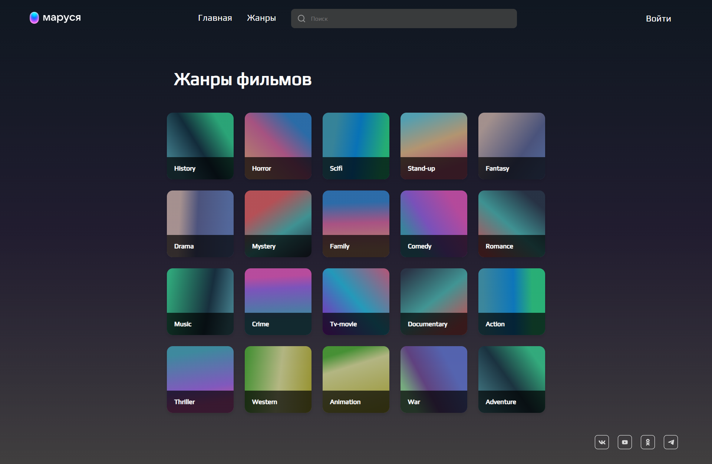

<div align="center">
    <h1>🎬 VK Marusya Movie App</h1>
    <p>Web application for viewing movie information with authorization, search, and favorites functionality.</p>
</div>

## 📸 Screenshots





## 🚀 Features

- React architecture with TypeScript
- Vite as build tool
- Movie information display including budget, revenue, director, and awards
- Responsive design with CSS modules
- GitHub Actions CI/CD pipeline
- Production-ready deployment to GitHub Pages

## ⚙️ Installation

1. Clone the repository
```bash
git clone [your-repository-url]
cd vk-marusya
```

2. Install dependencies
```bash
npm install
```

3. Start development server
```bash
npm run dev
```

## 🛠 Build

To build for production:
```bash
npm run build
```

## 📦 Project Structure

```
src/
├── animations/     # Animation configurations
├── api/           # API integrations and queries
├── components/    # Reusable components
├── pages/         # Application pages
├── store/         # State management
├── styles/        # Global styles
├── types/         # TypeScript type definitions
└── utils/         # Utility functions
```

## 🚀 Deployment

The project is automatically deployed to GitHub Pages using GitHub Actions when changes are pushed to the master branch.

## 🔑 Technologies

- React 18
- TypeScript
- Redux Toolkit
- React Query
- React Router
- CSS Modules
- Axios
- Zod
- Vite

## 📝 License


Этот проект распространяется под лицензией [MIT](./LICENSE).
